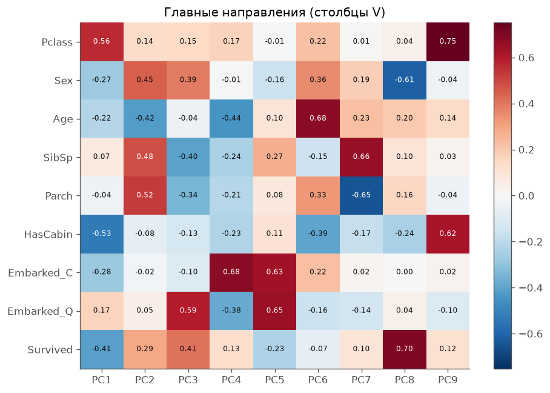
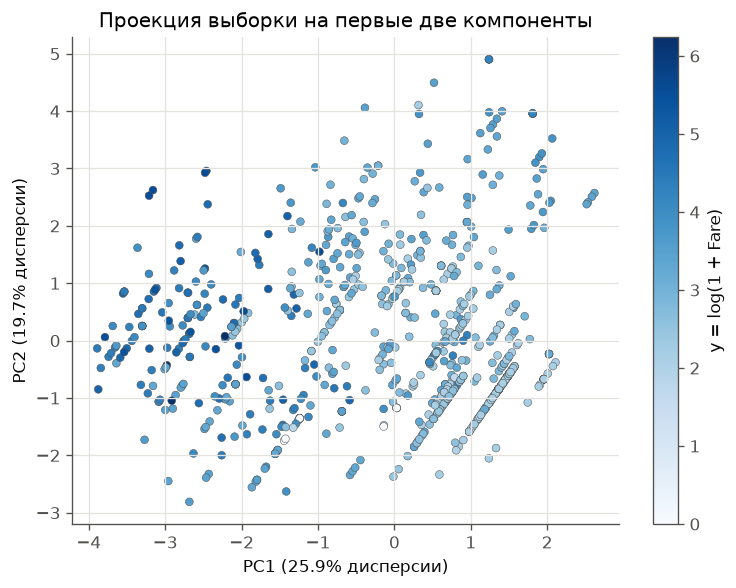
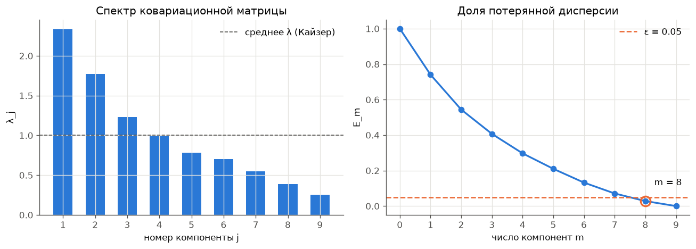
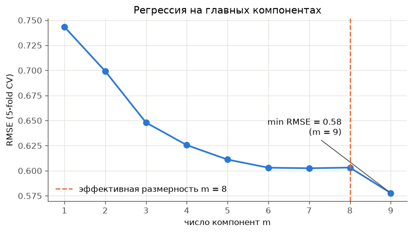

# Лабораторная работа №4. PCA

Вавилова Варвара

PCA реализован через сингулярное разложение, по спектру определена эффективная размерность выборки, результат сверен с `sklearn.decomposition.PCA`.

## Запуск

```bash
cd students/vavilova-vl/lab4
uv run python source/main.py
```

Скрипт печатает все таблицы из отчёта и сохраняет графики в `images/`.

## Структура

| Файл | Назначение |
|---|---|
| [source/Titanic-Dataset.csv](source/Titanic-Dataset.csv) | исходные данные |
| [source/data.py](source/data.py) | загрузка, построение признаков, стандартизация |
| [source/pca.py](source/pca.py) | класс `PCA`: `fit`, `transform`, `fit_transform`, `inverse_transform` через SVD |
| [source/dimension.py](source/dimension.py) | доля потерянной дисперсии $E_m$, эффективная размерность, правило Кайзера, число обусловленности |
| [source/reference.py](source/reference.py) | сравнение с `sklearn.decomposition.PCA`, ошибка восстановления |
| [source/regression.py](source/regression.py) | МНК через SVD и регрессия на главных компонентах (PCR) с кросс-валидацией |
| [source/plots.py](source/plots.py) | графики |
| [source/main.py](source/main.py) | точка входа: запускает все эксперименты |

## 1. Датасет

**Titanic**: $\ell = 891$ пассажир.

**Целевая переменная** — $y = \log(1 + \text{Fare})$, стоимость билета. Это единственный непрерывный признак датасета, поэтому он и выбран целью регрессии. Распределение Fare сильно скошено (медиана 14, максимум 512); логарифм делает зависимость от признаков ближе к линейной и не даёт нескольким дорогим билетам определять всю модель. Плюс единица нужна, потому что у 15 пассажиров Fare = 0.

**Признаки** ($n = 9$):

| Признак | Как получен |
|---|---|
| `Pclass` | класс билета 1–3 |
| `Sex` | 1 — женщина, 0 — мужчина |
| `Age` | возраст; 177 пропусков заполнены медианой (28 лет) |
| `SibSp`, `Parch` | число братьев/сестёр/супругов и родителей/детей на борту |
| `HasCabin` | 1, если номер каюты известен |
| `Embarked_C`, `Embarked_Q` | индикаторы порта посадки; S — базовый, 2 пропуска заполнены значением S |
| `Survived` | выжил ли пассажир |

`Name`, `Ticket` и `PassengerId` — идентификаторы, они не используются. Для порта взяты два индикатора, а не три: сумма трёх всегда равна 1, и это дало бы точную линейную зависимость и нулевое собственное значение.

Все признаки приведены к нулевому среднему и единичной дисперсии, иначе первые компоненты определял бы `Age`, у которого самый крупный масштаб.

## 2. PCA через сингулярное разложение

Пусть $F$ — центрированная матрица «объекты–признаки» размера $\ell \times n$. Её сингулярное разложение:

$$F = U \Sigma V^\top, \quad U^\top U = I, \quad V^\top V = I, \quad \Sigma = \mathrm{diag}(\sigma_1 \ge \dots \ge \sigma_n).$$

Тогда $F^\top F = V \Sigma^2 V^\top$, то есть:

- столбцы $V$ — собственные векторы ковариационной матрицы, или **главные направления**;
- $\lambda_j = \sigma_j^2 / (\ell - 1)$ — её собственные значения, то есть дисперсия вдоль $j$-го направления;
- новые признаки — проекции на первые $m$ направлений: $G = F V_m = U_m \Sigma_m$;
- восстановление: $\hat F = G V_m^\top$.

Ковариационную матрицу явно не строим: SVD работает с $F$ напрямую и численно устойчивее. Векторы $u_j, v_j$ определены с точностью до одновременной смены знака, поэтому знак фиксируется так, чтобы наибольшая по модулю координата $v_j$ была положительной.

Спектр на нашей выборке:

| $j$ | $\sigma_j$ | $\lambda_j$ | доля дисперсии | накопленная доля | $E_j$ |
|---:|---:|---:|---:|---:|---:|
| 1 | 45.600 | 2.3364 | 25.93% | 25.93% | 0.7407 |
| 2 | 39.725 | 1.7732 | 19.68% | 45.61% | 0.5439 |
| 3 | 33.123 | 1.2327 | 13.68% | 59.29% | 0.4071 |
| 4 | 29.681 | 0.9898 | 10.99% | 70.28% | 0.2972 |
| 5 | 26.420 | 0.7843 | 8.70% | 78.98% | 0.2102 |
| 6 | 24.983 | 0.7013 | 7.78% | 86.77% | 0.1323 |
| 7 | 22.158 | 0.5516 | 6.12% | 92.89% | 0.0711 |
| 8 | 18.557 | 0.3869 | 4.29% | 97.18% | 0.0282 |
| 9 | 15.032 | 0.2539 | 2.82% | 100.00% | 0.0000 |

Для контроля $\lambda_j$ из SVD сравнены с собственными значениями `np.cov(X)`: расхождение $5.3 \cdot 10^{-15}$.



Как устроены компоненты:

- **PC1** (26%) — «социальный статус»: высокий `Pclass` (дешёвый класс), нет каюты, не выжил. Это главная ось датасета.
- **PC2** (20%) — «семья»: `SibSp`, `Parch` и `Sex` с одной стороны, `Age` с другой, то есть молодые пассажиры с родственниками.
- **PC4, PC5** — почти целиком порт посадки.
- **PC9** (2.8%) $\approx 0.75\,\text{Pclass} + 0.62\,\text{HasCabin}$. `Pclass` и `HasCabin` сильно отрицательно коррелированы ($r = -0.73$): у первого класса каюта почти всегда известна. Вдоль направления, где они растут вместе, дисперсия поэтому мала. Это пассажиры, у которых класс и наличие каюты «противоречат» друг другу.



В проекции на первые две компоненты (46% дисперсии) цена билета явно растёт справа налево, вдоль PC1. Наклонные полосы — следствие дискретных признаков (`Pclass`, `SibSp`, `Parch`, индикаторы).

## 3. Эффективная размерность

Доля дисперсии, которая теряется при переходе к первым $m$ компонентам:

$$E_m = \frac{\|G V_m^\top - F\|^2}{\|F\|^2} = \frac{\lambda_{m+1} + \dots + \lambda_n}{\lambda_1 + \dots + \lambda_n}.$$

**Эффективная размерность** — наименьшее $m$, при котором $E_m \le \varepsilon$.



| Критерий | $m$ |
|---|---:|
| $E_m \le 0.20$ | 6 |
| $E_m \le 0.10$ | 7 |
| **$E_m \le 0.05$** | **8** |
| $E_m \le 0.01$ | 9 |
| правило Кайзера ($\lambda_j > \bar\lambda$) | 3 |

При $\varepsilon = 0.05$ эффективная размерность $m = 8$ из 9.

Спектр убывает плавно, без резкого обрыва: признаки Titanic в основном слабо коррелированы, и каждый несёт свою информацию. Поэтому ответ зависит от $\varepsilon$ — от 6 до 9 компонент. Число обусловленности $\mu = \lambda_{\max} / \lambda_{\min} = 9.2$ невелико: сильной мультиколлинеарности нет, и почти вырожденных направлений, которые стоило бы отбросить ради устойчивости, тоже нет. Сжать выборку без потерь, как в случае сильно коррелированных признаков, здесь не получается.

Правило Кайзера даёт всего 3 компоненты, но они объясняют лишь 59% дисперсии.

## 4. Эквивалентность с эталонной реализацией

Для каждого $m = 1, \dots, 9$ собственный `PCA(m)` сравнивался с `sklearn.decomposition.PCA(n_components=m, svd_solver="full")`. Перед сравнением знаки главных направлений выравниваются, потому что они определены неоднозначно. Сравнивались главные направления $V$, собственные значения $\lambda$, доли дисперсии, сингулярные числа $\sigma$, новые признаки $G$ и восстановленная матрица $\hat X$.

| $m$ | $V$ | $\lambda$ | доля | $\sigma$ | $G$ | $\hat X$ | смен знака |
|---:|---:|---:|---:|---:|---:|---:|---:|
| 1 | 4.4e-16 | 4.0e-15 | 4.4e-16 | 4.3e-14 | 3.1e-15 | 2.4e-15 | 0 |
| 2 | 6.4e-16 | 4.0e-15 | 4.4e-16 | 4.3e-14 | 3.6e-15 | 3.3e-15 | 0 |
| 3–9 | 2.6e-15 | 4.0e-15 | 4.4e-16 | 4.3e-14 | 1.1e-14 | ≤ 9.7e-15 | 0 |

В таблице — максимальное абсолютное расхождение. По всем $m$ и всем величинам оно не превышает $4.3 \cdot 10^{-14}$, то есть совпадение с точностью до машинной арифметики. Смен знака нет: выбранное правило фиксации знака совпадает с тем, что использует sklearn (`svd_flip`).


Относительные ошибки восстановления обеих реализаций совпадают между собой (расхождение $2 \cdot 10^{-16}$) и с теоретическим $E_m$, вычисленным только по спектру (расхождение $3 \cdot 10^{-16}$).

## 5. Проверка на задаче регрессии

Чтобы проверить, что найденная размерность имеет смысл для исходной задачи, строилась регрессия на главных компонентах (PCR): МНК через SVD на первых $m$ компонентах, оценка RMSE на 5-fold кросс-валидации. PCA обучается только на обучающей части каждого фолда.



| $m$ | 1 | 2 | 3 | 4 | 5 | 6 | 7 | **8** | 9 |
|---|---:|---:|---:|---:|---:|---:|---:|---:|---:|
| RMSE | 0.743 | 0.699 | 0.648 | 0.626 | 0.611 | 0.603 | 0.602 | **0.603** | 0.578 |

RMSE измеряется в единицах $\log(1 + \text{Fare})$: ошибка 0.58 соответствует отклонению цены примерно в $e^{0.58} \approx 1.8$ раза.

- Первая компонента сразу даёт основную часть качества: стандартное отклонение $y$ равно 0.97, а одна PC1 снижает ошибку до 0.74.
- С 6-й по 8-ю компоненту качество не меняется (около 0.603).
- **Последняя, 9-я компонента даёт самый большой прирост на хвосте**: RMSE падает с 0.603 до 0.578. Это PC9 = «`Pclass` + `HasCabin`», направление с наименьшей дисперсией. Цена билета определяется прежде всего классом, а наличие каюты связано с ней слабее. PC9 как раз отделяет класс от наличия каюты, и эта разница для цены важна.

Отсюда главный вывод этого раздела. **PCA не смотрит на целевую переменную**: компонента с маленькой дисперсией признаков может быть сильно связана с $y$. Отбор компонент по $E_m$ хорош для сжатия признакового описания, но для регрессии его нужно проверять на кросс-валидации. На данных Titanic отбрасывать компоненты не нужно: модель на всех 9 признаках лучше, а мультиколлинеарность слабая ($\mu = 9.2$), так что регуляризация через PCA ничего не даёт. Норма коэффициентов уменьшается лишь немного: с 0.663 (МНК на всех признаках) до 0.571 (8 компонент).

## Выводы

1. PCA реализован через SVD центрированной матрицы. Главные направления — правые сингулярные векторы, дисперсии компонент — $\sigma_j^2 / (\ell - 1)$.
2. Эффективная размерность выборки Titanic при $\varepsilon = 0.05$ равна **8 из 9**. Спектр плоский ($\mu = 9.2$), признаки слабо коррелированы, и выборку нельзя существенно сжать без потери информации.
3. Собственная реализация совпадает с `sklearn.decomposition.PCA` по всем величинам с точностью до $4.3 \cdot 10^{-14}$.
4. В регрессии на $\log(1 + \text{Fare})$ лучший результат даёт полный набор компонент (RMSE 0.578). Отброшенная по критерию $E_m$ компонента PC9 оказалась полезной для прогноза: малая дисперсия признаков не означает малую связь с целевой переменной.
